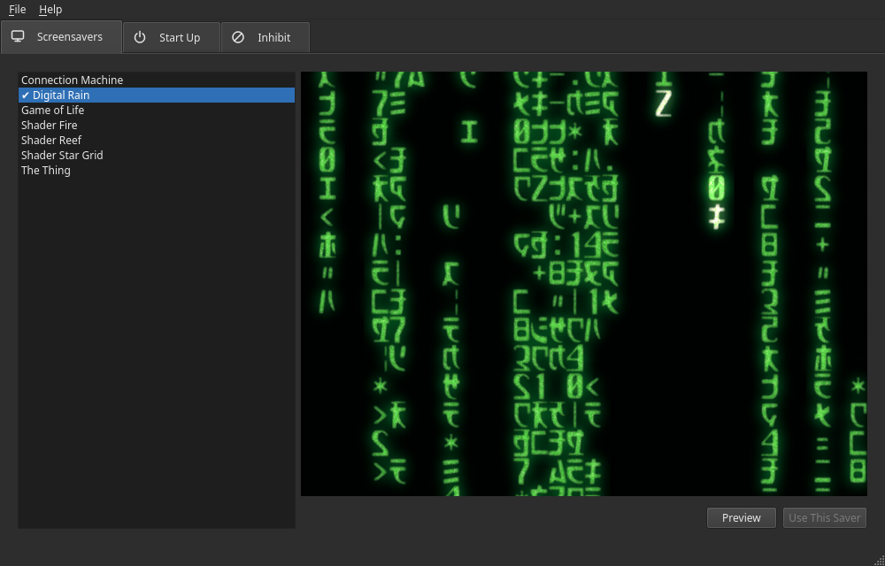
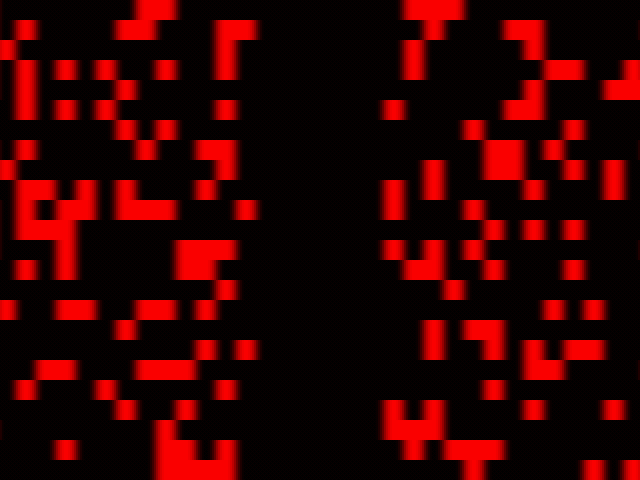
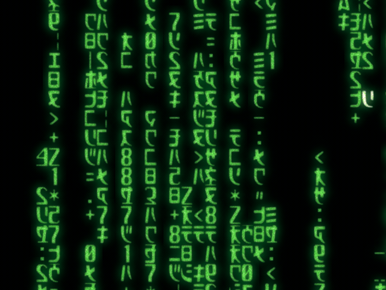
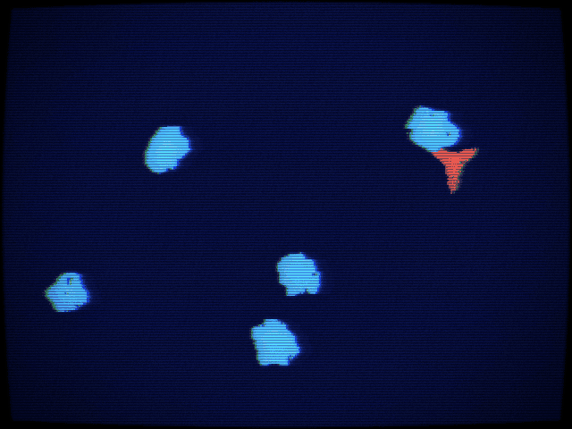

#  Linux Screensaver

A simple Linux screensaver framework, with a desktop app to manage it.



## Prerequisites

* This is a Linux only screensaver framework.
* The launcher detects input using the backend that suits the current desktop (via `XDG_CURRENT_DESKTOP`).
    * On [Gnome](https://www.gnome.org/), input detection is handled by [Mutter](https://mutter.gnome.org/) and both [X11](https://www.x.org/wiki/) and [Wayland](https://wayland.freedesktop.org/) are supported.
    * On other desktops (e.g. [KDE Plasma](https://kde.org/plasma-desktop/)), input detection is handled by the [Wayland](https://wayland.freedesktop.org/) `ext-idle-notify-v1` protocol, so a Wayland session and `libwayland-client` are required.
* A working Go and C compiler and installed Raylib dependencies.
    * https://go.dev
    * https://github.com/gen2brain/raylib-go#requirements
* For the manager only, Qt 6 and its development files, and a C++ compiler.

## How it works

The framework is modular: it is made of separate programs, each of which does
one job and runs on its own.

| Program                | What it does |
|------------------------|--------------|
| `screensaver-launcher` | Waits for there to be no input for a time, then runs a saver. |
| `screensaver-*`        | The savers. Each draws something nice full screen and exits when input is detected. Any one can be run by hand. |
| `screensaver-command`  | Sends commands to a running launcher. |
| `screensaver-manager`  | An optional desktop app to choose, preview and run a saver at login. |

The launcher needs nothing but the name of a saver: its timer starts and any
input resets it. When it expires, the launcher runs the saver and waits for it
to exit. Everything is given to it on the command line; it reads no config
file, so it can be started however you like, with or without the manager. Any
executable can be launched, not only the savers here.

The manager is a convenience on top: it keeps your choices in its own settings
and runs the launcher with them as its options, as a systemd user service.

## Install

```
make install
```

This compiles and installs the launcher, the command tool, every saver and the
manager into `$GOBIN` (or `$GOPATH/bin`). That directory must be in your
`PATH`, as the savers are run by name.

## Launcher

```
screensaver-launcher -saver screensaver-digital-rain -timer 15m -inhibit vlc,mpv,steam
```

| Option     | Description |
|------------|-------------|
| `-saver`   | The screensaver to show when the timer runs out. Required. |
| `-timer`   | How long to wait for input before showing it (default `15m`). |
| `-inhibit` | Process names, separated by commas. While any of them is running, the saver is not shown when the timer expires; the timer simply starts again. A name matches a process whose name (as `top` shows it) or program file name is exactly that name. |
| `-port`    | The port the command tool talks to it on (default `1337`). |

## Add to startup

Use the Screensaver Manager to install the launcher as a systemd user service,
which starts with the desktop session. Or start the launcher any other way,
such as from a startup application:

```
screensaver-launcher -saver screensaver-game-of-life > /dev/null 2>&1
```

## Screensaver Manager

A Qt 6 app, built with [miqt](https://github.com/mappu/miqt), to manage the
launcher. Building it needs Qt 6 and its development files.

* *Screensavers* lists every saver by name, with the one in use marked and
  selected. The selected one's preview plays beside the list. *Preview* runs
  the real saver full screen; *Use This Saver* makes it the one the launcher
  shows.
* *Start Up*: *Install* writes
  `~/.config/systemd/user/screensaver-launcher.service`, which starts with the
  desktop session, and starts it. Its status is shown and kept up to date;
  *Start*, *Stop* and *Uninstall* control it, and *Show after* sets the timer.
  A launcher started some other way is pointed out, as it holds the port the
  service's launcher needs.
* *Inhibit* lists the processes that stop the saver being shown, each with
  whether it is running now.
* *File › Settings* (Ctrl+,) chooses the theme: light, dark, or following the
  system.

What is chosen is kept in `~/.config/screensaver-manager/settings.json`. Nothing
is set until you choose it. The service runs the launcher with your choices as
its options (`-saver`, `-timer`, `-inhibit`), and each change rewrites the
service and restarts the launcher if it is running.

The launcher's output goes to the journal:
`journalctl --user -u screensaver-launcher.service -f`.

```
make build      # ./screensaver-manager
make run        # builds and runs it
make test       # its tests, with the race detector; the UI's run offscreen
make vet
make screenshot # draws manager/screenshot.png
```

## Commands

You can use the command tool to send commands to the launcher to control its behaviour.

| Command                         | Description                                         |
|---------------------------------|-----------------------------------------------------|
| `screensaver-command -reset`    | Reset the launcher timer.                           |
| `screensaver-command -activate` | Expires the timer and activate the specified saver. |

## Savers

Each saver is a directory of `screen/saver`, such as `digital_rain`, with its
program in a file named for it, `screensaver-digital-rain.go`, and its preview
in `assets/images/preview.gif`.
`make install` installs a new one, and the manager lists it once it is built
again, as it builds the previews into itself.

### `screensaver-connection-machine`


### `screensaver-digital-rain`


### `screensaver-game-of-life`


### `screensaver-shader-fire`


### `screensaver-shader-reef`


### `screensaver-shader-star-grid`


### `screensaver-the-thing`

